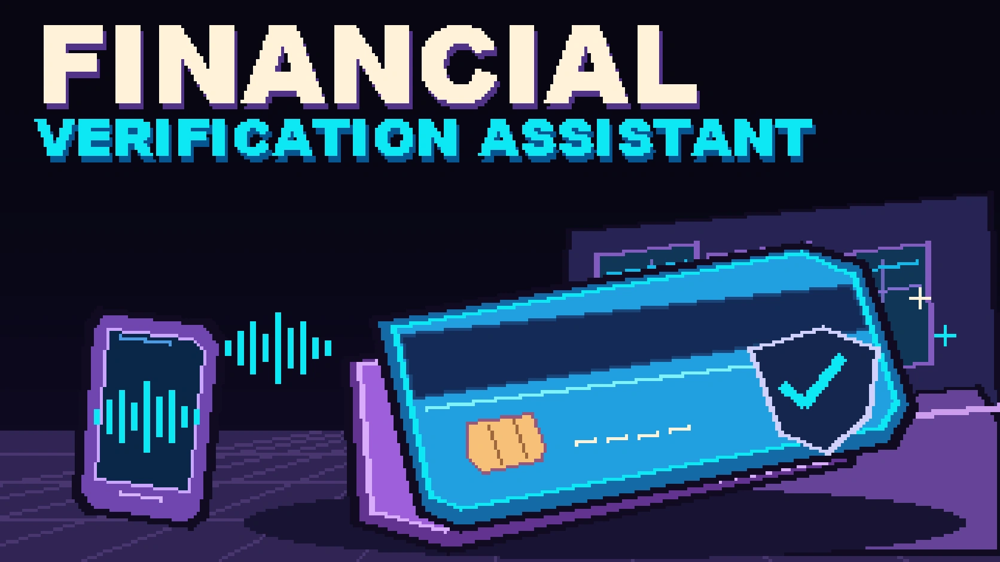

# Agora Financial Verification Assistant Demo

[English](README.md) | [简体中文](README.zh-CN.md) | [日本語](README.ja.md)



公開の練習用フレーズで本人確認を模擬し、身に覚えのない取引の申告やサンプルカードの利用停止を練習します。実際のカード番号、パスワード、認証コードは入力しないでください。 このデモでは架空の資料を使用し、会話の結果を口頭の下書きとして伝えます。

## ローカルで実行

Node.js 24、pnpm 9.15.9、Conversational AI を有効にした Agora プロジェクトを用意します。アプリの起動前に、`.env.local` の `NEXT_PUBLIC_AGORA_APP_ID` と `NEXT_AGORA_APP_CERTIFICATE` を設定します。App Certificate はサーバー側で管理してください。

```bash
cp env.local.example .env.local
pnpm install --frozen-lockfile
pnpm run doctor
pnpm dev
```

ターミナルに表示された URL を開き、マイクの使用を許可します。

## 会話と検証

「training pass」と話してから、「I would like to practice reporting an unfamiliar card charge.」と言ってみてください。「training fail」で確認に失敗する流れも試せます。 最後に、更新した内容の要約を依頼してください。

`pnpm run verify` でテンプレート、モック API、本番ビルドを検証できます。音声の動作はブラウザーで実際に通話して確認します。[シナリオの説明](RECIPE.md)と[npm・Vercel の設定](https://github.com/AgoraIO-Community/agora-financial-verification-demo/blob/main/docs/npm-release.md)も参照してください。
